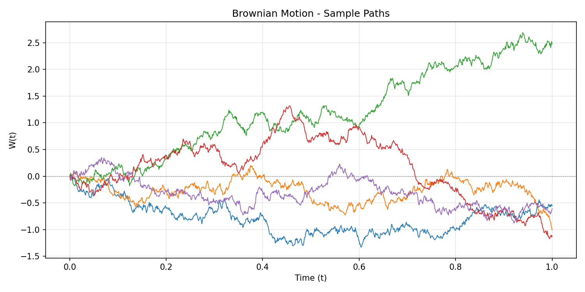
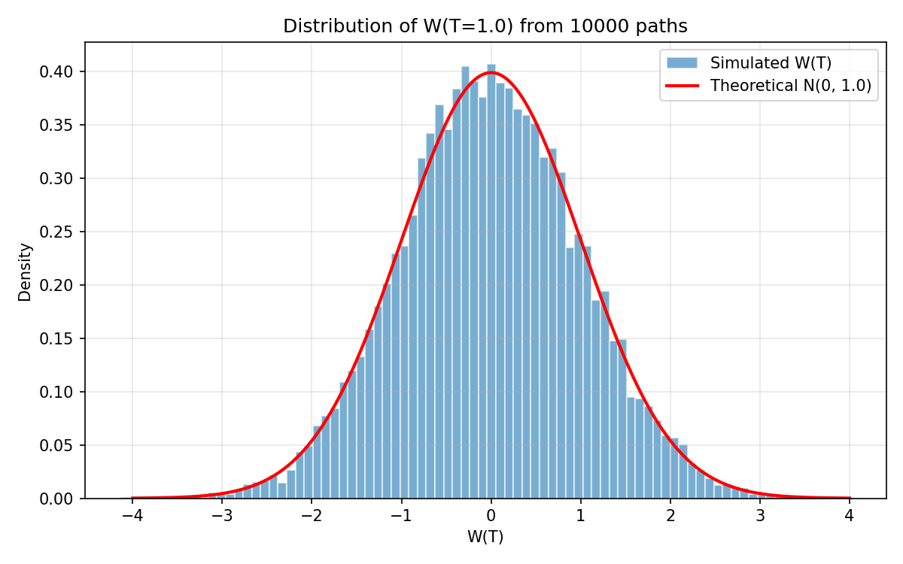
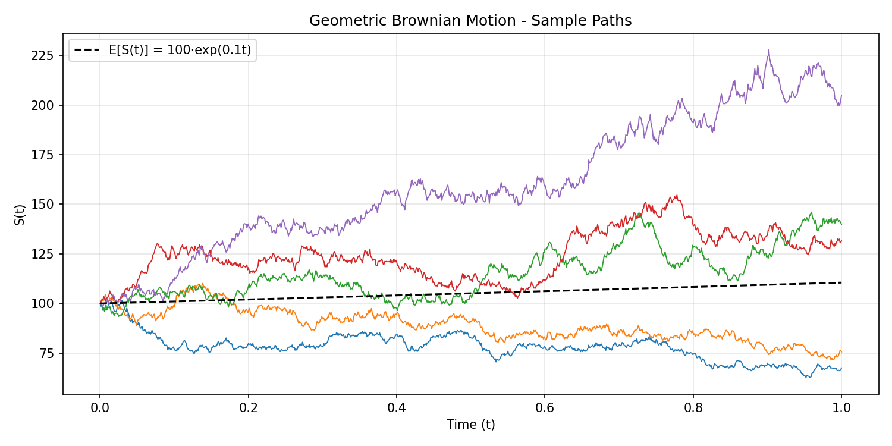
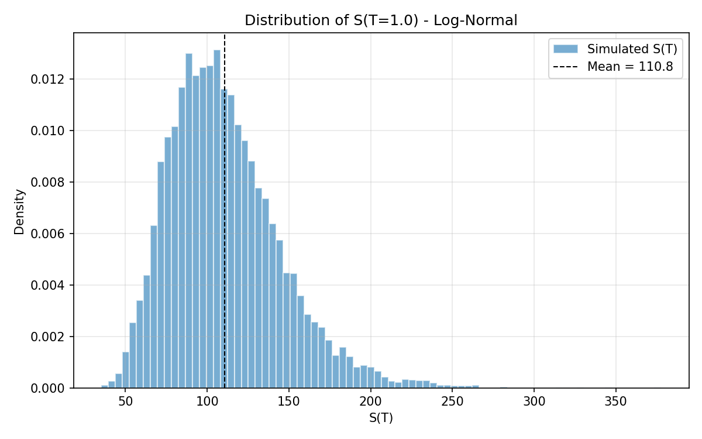
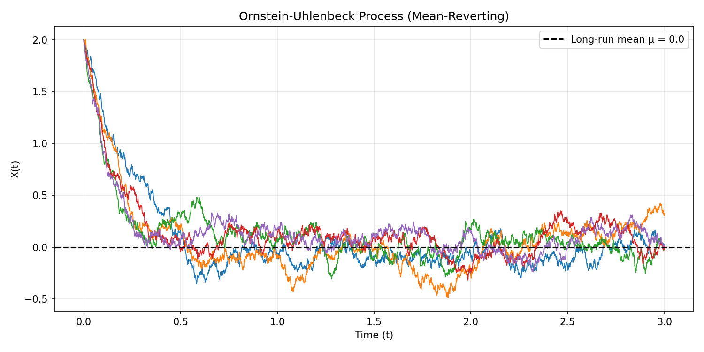
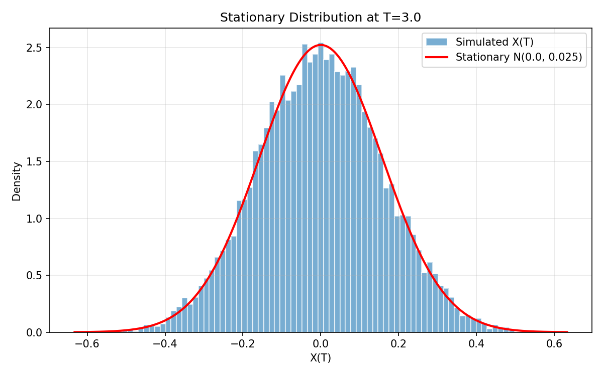
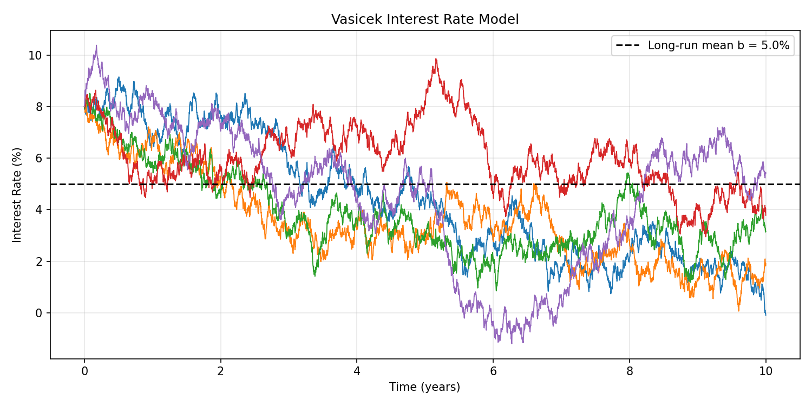
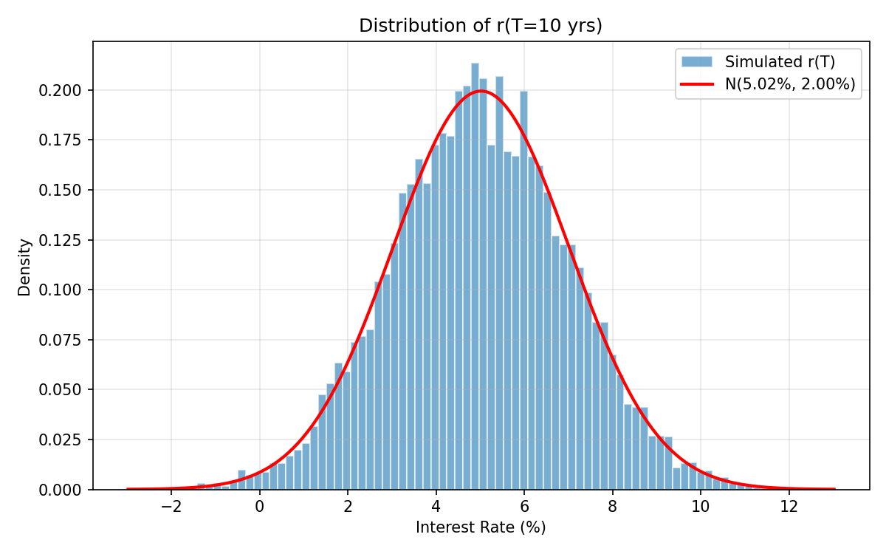

# Financial Mathematics - Individual Project

**Dasari Veera Venkata Abhinav Teja | 23CS10017**

Simulations of four stochastic processes commonly used in financial mathematics. Each one is implemented from scratch in Python.

## What's in here

1. **Brownian Motion** : the building block for everything else
2. **Geometric Brownian Motion** : stock price modeling (Black-Scholes)
3. **Ornstein-Uhlenbeck Process** : mean-reverting dynamics
4. **Vasicek Interest Rate Model** : short-rate modeling

## 1. Brownian Motion

W(t) is defined by: W(0) = 0, independent Gaussian increments with W(t) − W(s) ~ N(0, t−s), and continuous paths.

To simulate, I discretized [0, T] into N steps of size dt = T/N. Each increment is just dW = √dt · Z where Z is a standard normal. The path is the cumulative sum of these increments.

The code generates 5 sample paths and also runs 10,000 Monte Carlo paths to check that W(T) actually follows N(0, T). The histogram lines up with the theoretical density, so we're good.




## 2. Geometric Brownian Motion

The SDE is dS = μ·S·dt + σ·S·dW, which has a closed-form solution via Itô's lemma:

S(t) = S₀ · exp((μ − σ²/2)·t + σ·W(t))

So I just reused the Brownian motion path from before and plugged it into an exponential. The μ − σ²/2 term is the Itô correction that shows up when you apply the lemma to log(S).

Used S₀ = 100, μ = 0.1 (10% return), σ = 0.3 (30% vol). Prices always stay positive because of the exp(), which is the whole point of using GBM over plain BM for asset prices. The terminal distribution comes out log-normal (right-skewed), as expected.




## 3. Ornstein-Uhlenbeck Process

dX = θ(μ − X)dt + σ·dW

This one mean-reverts. When X drifts above μ, the drift term pulls it back down, and vice versa. θ controls how aggressively it snaps back, i.e basically a spring constant.

I started the paths at X₀ = 2.0, way above μ = 0, on purpose. You can clearly see all paths getting dragged down fast initially (the drift dominates), and then once they reach the neighborhood of μ they just fluctuate around it. After enough time the process settles into its stationary distribution N(μ, σ²/2θ), regardless of where it started.




## 4. Vasicek Interest Rate Model

dr = a(b − r)dt + σ·dW

Structurally the same SDE as OU, but applied to interest rates. r is the short rate, b is the long-run mean, a is the reversion speed. I used a = 0.5, b = 5%, σ = 2%, starting at r₀ = 8%.

The rates drift down from 8% toward the 5% long-run mean over ~10 years. One thing worth noting, i.e some paths dip below zero. That's a known limitation of Vasicek (the CIR model fixes this).




## Running the code

```bash
pip install numpy matplotlib
python brownian_motion.py
python gbm.py
python ou_process.py
python vasicek.py
```

Each script generates its own plots and saves them as PNGs."# FinancialMathsProject" 
